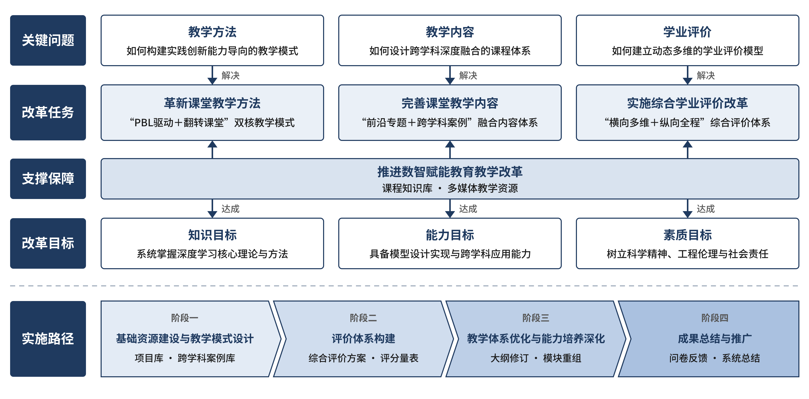
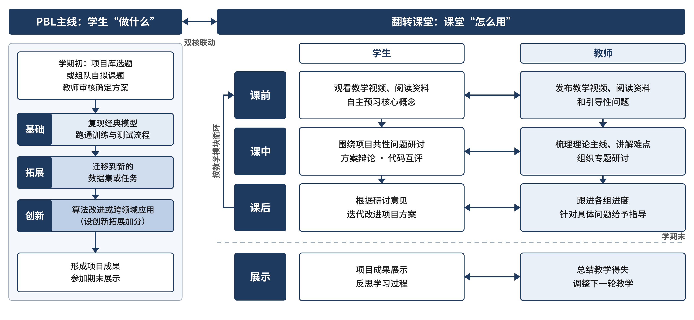
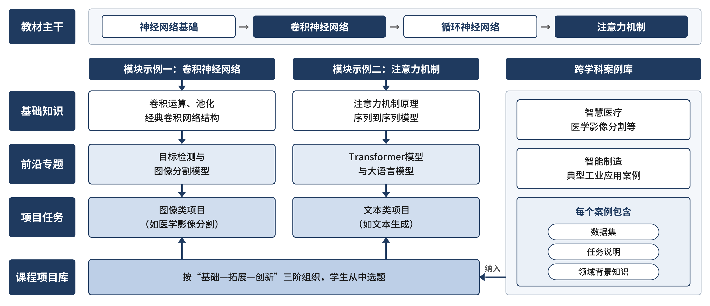

# 教改年检报告配图

《深度学习及应用》课堂教学改革项目 年度检查报告 / 结题验收报告配图。

| 文件 | 说明 |
|---|---|
| 图1_项目总体实施框架.png | 第一部分 1. 项目总体实施情况 |
| 图2_PBL驱动+翻转课堂双核教学模式.png | 第一部分 2.（1）革新课堂教学方法 |
| 图3_课程内容结构.png | 第一部分 2.（2）完善课堂教学内容（专题与案例为示例，待老师确认后更新） |

